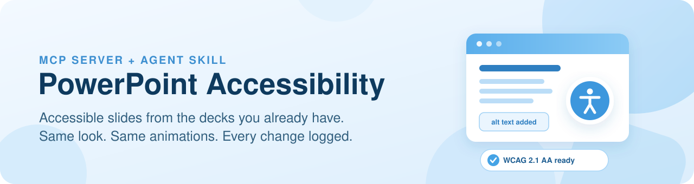
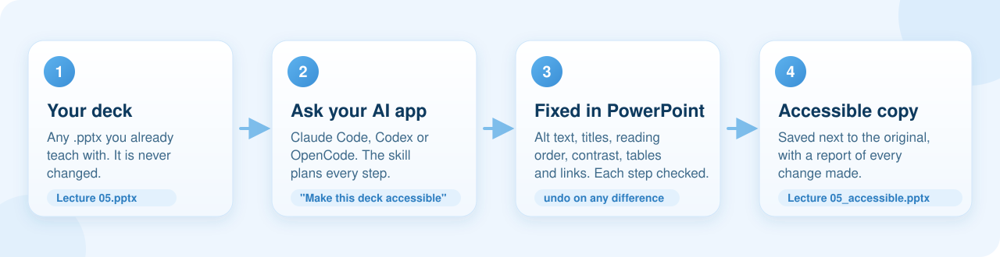

<p align="center">
  <picture>
    <source media="(prefers-color-scheme: dark)" srcset="docs/assets/banner-dark.svg">
    
  </picture>
</p>

<p align="center">
  <b>Make your PowerPoint lectures WCAG 2.1 AA accessible by asking your AI assistant.</b><br>
  An MCP server and agent skill for Claude Code, Codex and OpenCode on Windows.
</p>

<p align="center">
  
  
  
  
  <a href="LICENSE"></a>
</p>

<p align="center">
  <a href="#quick-start">Quick start</a>
  &nbsp;·&nbsp;
  <a href="#example-prompts">Example prompts</a>
  &nbsp;·&nbsp;
  <a href="#what-gets-fixed">What gets fixed</a>
  &nbsp;·&nbsp;
  <a href="#set-up-by-app">Set up by app</a>
  &nbsp;·&nbsp;
  <a href="#faq">FAQ</a>
</p>

---

Making a lecture deck accessible by hand takes hours: alt text for every figure, checking what a screen
reader reads and in which order, fixing slide titles, colours, tables and links, then checking it all
again. This project lets your AI assistant do that work **inside the PowerPoint you already have**, on a
copy of your deck, while keeping every slide looking and animating exactly as before.

- **Your original is never touched.** The result is saved next to it as `Lecture 05_accessible.pptx`.
- **Nothing breaks.** Figures keep their animations, slides keep their design. Every invisible change is
  checked against a render of the slide and undone if anything moved.
- **Only what accessibility rules require changes visibly,** such as a text colour nudged to the nearest passing shade or
  "(2 of 3)" on a repeated title, and every such change is logged with before and after values.
- **It checks its own work** with a WCAG audit of everything it fixes, plus PowerPoint's built-in
  Accessibility Checker.
- **Your words are kept.** If you already wrote alt text in a spreadsheet, it is used exactly as written.

## How it works

<p align="center">
  <picture>
    <source media="(prefers-color-scheme: dark)" srcset="docs/assets/how-it-works-dark.svg">
    
  </picture>
</p>

The **MCP server** (`ppt-a11y`) gives your AI app 46 precise tools that drive desktop PowerPoint. The
**skill** (`pptx-wcag-alt-text`) teaches the app the whole process: what to check, in what order, what it
may change, and when the deck is done. More detail: [How it works](docs/how-it-works.md).

## Requirements

- Windows 10 or 11
- Desktop PowerPoint from Microsoft 365. PowerPoint for the web and for Mac are not supported, because the
  tool needs Windows automation. The final check with PowerPoint's own Accessibility Checker needs
  PowerPoint in English; in other languages the tool's own audit still runs and the report says so.
- Decks in a regular folder on your computer (for example `C:\Slides`). Decks opened from OneDrive or
  SharePoint folders may not work; copy them to a local folder first.
- One AI app that runs on Windows: [Claude Code](https://code.claude.com/docs/en/setup),
  [Codex](https://github.com/openai/codex) or [OpenCode](https://opencode.ai/docs/)

You do not need to install Python. The installer brings its own.

## Quick start

**1. Open PowerShell** (press the Windows key, type `PowerShell`, press Enter) and paste:

```powershell
irm https://raw.githubusercontent.com/ricardofrodriguezjr/powerpoint-accessibility-mcp/main/install.ps1 | iex
```

**2. Restart your AI app** (or start a new session).

**3. Ask it to fix a deck:**

```text
Make "C:\Users\me\Documents\STAT 101\Lecture 05.pptx" WCAG 2.1 AA compliant.
Save the _accessible copy in the same folder and summarize what you changed.
```

That's it. The installer sets up every app it finds: Claude Code and OpenCode through their commands, and
Codex through its command or its settings folder. Close those apps before running it.

<details>
<summary><b>What the installer does</b></summary>

1. Checks that Windows and desktop PowerPoint are present.
2. Installs [uv](https://docs.astral.sh/uv/) if needed, which provides a private Python.
3. Downloads this repository to `%USERPROFILE%\.ppt-a11y\app` and installs its Python packages there.
4. Checks that the server starts and lists its tools.
5. For each app it finds: registers the server and copies the skill into the app's skills folder. Any
   settings file it edits is backed up first to `%USERPROFILE%\.ppt-a11y\backups`.

Run the same command again to update. To set up only some apps:

```powershell
& ([scriptblock]::Create((irm https://raw.githubusercontent.com/ricardofrodriguezjr/powerpoint-accessibility-mcp/main/install.ps1))) -Apps claude,codex
```

Prefer to read the script first? Download [`install.ps1`](install.ps1), then run
`powershell -ExecutionPolicy Bypass -File .\install.ps1`. To remove it, use
[`uninstall.ps1`](uninstall.ps1) the same way.

</details>

## Example prompts

Copy one, change the path to your file, and paste it into your app. Any request to make a PowerPoint
accessible starts the skill.

> **Tip:** hold **Shift**, right-click your file in File Explorer and choose **Copy as path**.

**Make one deck accessible**

```text
Make "C:\Users\me\Documents\STAT 101\Lecture 05.pptx" WCAG 2.1 AA compliant.
Save the result as an _accessible copy in the same folder and give me a short
summary of what you changed.
```

**Use alt text you already wrote**

```text
Make "C:\Users\me\Documents\STAT 101\Lecture 05.pptx" accessible. Use the alt text
in "C:\Users\me\Documents\STAT 101\Lecture 05 alt text.xlsx" exactly as written.
Put the _accessible copy in the same folder.
```

**Do a whole folder**

```text
Make every PowerPoint in "C:\Users\me\Documents\STAT 101\Slides" accessible, one
deck at a time. Skip files that already end in _accessible. Save each _accessible
copy next to its original and give me one summary table at the end.
```

**Check first, change nothing**

```text
Check "C:\Users\me\Documents\STAT 101\Lecture 05.pptx" for accessibility problems.
Do not change anything yet. List what is missing on each slide.
```

More prompts, and what to expect while it works: [Example prompts](docs/example-prompts.md).

## What gets fixed

| WCAG 2.1 | Problem | What happens | Visible? |
|---|---|---|---|
| 1.1.1 | Pictures, charts and diagrams without alt text | Alt text is written (or taken from your spreadsheet); purely decorative objects are marked decorative; multi-piece figures are grouped and keep their animations | No |
| 2.4.2, 2.4.6 | Slides with no title, or the same title | The visible heading becomes the real title with an identical look; repeated section banners get hidden titles; continued topics become "Topic (2 of 3)" | Only "(n of N)" |
| 1.3.2, 2.4.3 | Screen readers read objects in the wrong order | Objects are restacked so the title is read first, content in visual order and footers last | No |
| 1.4.3 | Text that is too light for its background | Contrast is measured against what is really drawn behind the text, and the colour is nudged to the nearest shade that passes | Slightly |
| 1.3.1 | Tables with merged cells or no header row | Diagram tables become identical-looking text boxes; data tables are unmerged and get a header row | Rarely |
| 2.4.4 | Raw or broken link text | Replaced with a short description of the destination; the link keeps working | Yes |

When the deck is finished, you get:

- `Lecture 05_accessible.pptx` next to your original;
- `Lecture 05_accessible_a11y_checks\` with the audit report and a change log listing every change, with
  before and after values;
- a summary in the chat, including anything that needs your decision.

## What it does not check

These still need a person:

- captions and transcripts for video or audio in the deck (WCAG 1.2);
- meaning shown only by colour, such as "the red line is the test error" (1.4.1);
- contrast of chart lines, arrows and icons (1.4.11);
- the deck's language setting (3.1.1);
- slides or media that advance or play on their own (2.2.2);
- whether each alt text is accurate. The app writes good descriptions, but you know your content best.

This tool fixes the items above and checks its own work. It does not certify compliance and is not legal
advice. Review the result, especially the alt text, before you share the deck.

## Set up by app

The Quick start configures these automatically. Expand one to check it or set it up by hand; full steps are
in [Manual setup](docs/manual-setup.md).

<details>
<summary><b>Claude Code</b></summary>

```powershell
claude mcp add --scope user ppt-a11y -- "$env:USERPROFILE\.ppt-a11y\app\.venv\Scripts\python.exe" "$env:USERPROFILE\.ppt-a11y\app\server.py"
New-Item -ItemType Directory -Force "$env:USERPROFILE\.claude\skills" | Out-Null
Copy-Item -Recurse -Force "$env:USERPROFILE\.ppt-a11y\app\skills\pptx-wcag-alt-text" "$env:USERPROFILE\.claude\skills\"
```

Check: start a new session and type `/mcp`. Use the skill by name with `/pptx-wcag-alt-text`, or just ask.
A deck needs many tool calls: when Claude Code asks to use a PowerPoint tool, answer
**Yes, and don't ask again** (or add `mcp__ppt-a11y` to the allowed tools with `/permissions`).

</details>

<details>
<summary><b>Codex</b></summary>

```powershell
codex mcp add ppt-a11y '--' "$env:USERPROFILE\.ppt-a11y\app\.venv\Scripts\python.exe" "$env:USERPROFILE\.ppt-a11y\app\server.py"
New-Item -ItemType Directory -Force "$env:USERPROFILE\.agents\skills" | Out-Null
Copy-Item -Recurse -Force "$env:USERPROFILE\.ppt-a11y\app\skills\pptx-wcag-alt-text" "$env:USERPROFILE\.agents\skills\"
```

Then open `%USERPROFILE%\.codex\config.toml`. Add these lines under the `[mcp_servers.ppt-a11y]` line the
command created, so long checks are not cut off and Codex does not ask before each tool call:

```toml
startup_timeout_sec = 60
tool_timeout_sec = 1800
default_tools_approval_mode = "approve"
```

And add this line at the very top of the file, so the tools are ready for your first message:

```toml
mcp_optional_startup_grace_ms = 5000
```

Check: restart Codex and type `/mcp`. Use the skill by name with `$pptx-wcag-alt-text`, or just ask. Keep the
agent on **Windows native**, not WSL.

</details>

<details>
<summary><b>OpenCode</b></summary>

Add this to `%USERPROFILE%\.config\opencode\opencode.json` (or to `opencode.jsonc` in the same folder if that
is the file you have; OpenCode reads both):

```json
{
  "$schema": "https://opencode.ai/config.json",
  "mcp": {
    "ppt-a11y": {
      "type": "local",
      "command": [
        "C:\\Users\\YOUR-NAME\\.ppt-a11y\\app\\.venv\\Scripts\\python.exe",
        "C:\\Users\\YOUR-NAME\\.ppt-a11y\\app\\server.py"
      ],
      "enabled": true,
      "timeout": 1800000
    }
  }
}
```

If the file already has content, keep a single outer `{ }`: add only the `"mcp"` part inside it (or, if it
already has an `"mcp"` section, only the `"ppt-a11y"` entry), with a comma after the entry before it.

OpenCode also reads skills from `%USERPROFILE%\.claude\skills` and `%USERPROFILE%\.agents\skills`. If you have
not set up Claude Code or Codex, install the skill with:

```powershell
New-Item -ItemType Directory -Force "$env:USERPROFILE\.agents\skills" | Out-Null
Copy-Item -Recurse -Force "$env:USERPROFILE\.ppt-a11y\app\skills\pptx-wcag-alt-text" "$env:USERPROFILE\.agents\skills\"
```

Check: restart OpenCode and run `opencode mcp list`. Run OpenCode directly in Windows (PowerShell or Windows
Terminal), not inside WSL.

</details>

<details>
<summary><b>Other MCP apps</b></summary>

Any app that supports local (stdio) MCP servers works. Use the command
`C:\Users\YOUR-NAME\.ppt-a11y\app\.venv\Scripts\python.exe` with one argument,
`C:\Users\YOUR-NAME\.ppt-a11y\app\server.py` (replace YOUR-NAME with your Windows user folder name). See
[Manual setup](docs/manual-setup.md#2-connect-your-app).

</details>

## Tested on real lectures

Two university lecture decks that had already been given alt text were run through the full process.

| | 45-slide statistics lecture | 15-slide Python lecture |
|---|---|---|
| Slides without a title | 9 to 0 | 0 |
| Slides sharing a title | 6 to 0 | 0 |
| Tables with merged cells | 2 to 0 | 0 |
| Text below the contrast minimum | 18 to 0 | 0 |
| Unclear links | 0 | 1 to 0 |
| Slides read in the wrong order | 37 to 0 | 5 to 0 |
| PowerPoint "Check reading order" prompts | 25 to 3 | 4 to 0 |

The statistics deck was a Google Slides export with 13 animated slides, including diagrams of up to 87
effects. After every step, each changed slide was compared with the original by render and its saved
animation data was checked; after the alt-text pass, the 13 animated slides were also played in Slide
Show and compared click by click. Only the logged changes differ. The 3 remaining prompts are code slides whose notes point into the code; their
reading order was checked and is correct (see the [FAQ](#faq)).

## FAQ

<details>
<summary><b>Will it change how my slides look?</b></summary>

Only where accessibility rules require it, and every such change is listed with before and after values: a text or
fill colour nudged to the nearest shade that passes contrast, "(2 of 3)" added to repeated titles,
descriptive link text, and repeated text in unmerged table cells. Everything else (alt text, titles that
look identical, reading order, grouping) is invisible and is verified to be invisible.

</details>

<details>
<summary><b>Does it keep my animations?</b></summary>

Yes. PowerPoint normally deletes animations when shapes are grouped; this tool re-creates them on the same
shapes inside the group and verifies the saved animation data is identical. It can also play the original
and the copy side by side in Slide Show and compare every click.

</details>

<details>
<summary><b>Does it send my slides anywhere?</b></summary>

The server runs entirely on your computer and talks only to PowerPoint and your AI app. Your AI app sends
what it reads (slide text, alt text, slide images when it looks at a slide) to its AI provider, as with any
file you open in that app. Use the app your institution approves for course materials. See
[Security and privacy](SECURITY.md).

</details>

<details>
<summary><b>Does it work on a Mac, or with Google Slides?</b></summary>

It needs Windows and desktop PowerPoint, because it drives PowerPoint itself. For Google Slides, download
the deck as .pptx, make it accessible, and upload the `_accessible` copy.

</details>

<details>
<summary><b>Which files does it work with?</b></summary>

PowerPoint files in .pptx or .pptm format, in a regular folder on your computer. For an older .ppt file, open
it in PowerPoint and choose File > Save As > PowerPoint Presentation (.pptx) first. If you have alt text in
a spreadsheet, save it as an Excel file (.xlsx) with column names in the first row; a column named
`Alt Text` works best.

</details>

<details>
<summary><b>How long does it take?</b></summary>

Usually 10 to 30 minutes for a 40-slide lecture with diagrams and animations. You can stop at any time: the
work is saved after every verified step, and you can ask the app to continue later.

</details>

<details>
<summary><b>PowerPoint's checker still says "Check reading order". Is something wrong?</b></summary>

That item is a prompt to double-check, not an error, and PowerPoint's rule for it is a guess based on
position. It can stay on for slides whose order is correct, for example a code slide where note arrows
point into the code. The report lists those slides and explains why their order is right.

</details>

<details>
<summary><b>Something went wrong. Where do I get help?</b></summary>

See [Troubleshooting](docs/troubleshooting.md), or open an
[issue](https://github.com/ricardofrodriguezjr/powerpoint-accessibility-mcp/issues).

</details>

## Documentation

| Page | For |
|---|---|
| [Example prompts](docs/example-prompts.md) | Ready-to-paste requests and what to expect |
| [Manual setup](docs/manual-setup.md) | Setting up by hand, or in another MCP app |
| [Troubleshooting](docs/troubleshooting.md) | Install and connection problems |
| [How it works](docs/how-it-works.md) | Safety rules, the animation fix, reading order and contrast in detail |
| [Tool reference](docs/tools.md) | The 46 MCP tools |
| [Skills](skills/README.md) | What the skill does and how to write your own |
| [Tests](tests/README.md) | How the tool's claims are verified |

## Contributing

Bug reports, test decks you can share, and pull requests are welcome. See [CONTRIBUTING.md](CONTRIBUTING.md).

## Credits

Forked from [powerpoint-mcp](https://github.com/Ayushmaniar/powerpoint-mcp) by Ayushmaniar (MIT, as declared
in its README and `pyproject.toml`), which showed how an MCP server can drive desktop PowerPoint through
pywin32. Built with the
[MCP Python SDK](https://github.com/modelcontextprotocol/python-sdk), [pywin32](https://github.com/mhammond/pywin32)
and [uv](https://github.com/astral-sh/uv).

## License

[MIT](LICENSE)
